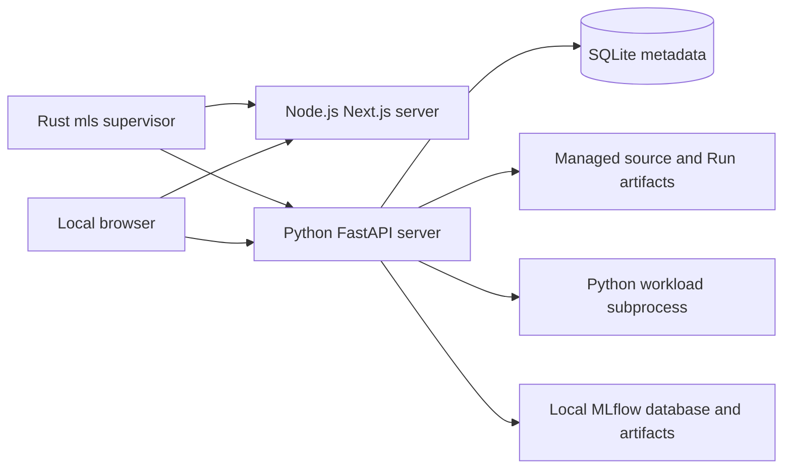

# Architecture - ML Studio beta

Current implementation: binary classification, multiclass classification and
regression; visual preparation/training; deterministic Python; immutable Runs,
Evaluate and secondary local MLflow; explicit Code Mode and a shared live viewer.
The [ADRs](decisions/README.md) and versioned phase contracts preserve decisions;
[current user guides](README.md) describe the public workflow.

## Processes and trust boundary

FastAPI and Next.js remain independent loopback servers. Rust installs, launches,
supervises and diagnoses them; it does not implement APIs, ML or rendering.
The source checkout remains required for editable installation and migrations.
Manual developer servers and CLI production servers are separate launch paths.

## Domain and exact-source execution

A Project is mutable workspace intent with a fixed task (`ml_objective`), one
active managed Dataset and immutable history. Dataset bytes are immutable and
SHA-256-bound. Replacement creates a new identity while retaining past sources.
IDs are domain identity; paths locate storage.

Working Pipeline IR may be incomplete, invalid or stale. Validation resolves a
versioned Effective Execution Plan without silently rewriting user intent. Code
preview binds Project revision, Dataset, plan hash and source hash. Admission
revalidates those identities before freezing a Run package. The executor launches
its exact persisted Python file, not another hidden sklearn implementation.
The generated workload verifies source bytes, splits before fitting preparation,
and emits bounded validated results and the complete fitted pipeline.

| Task | IR / plan | Compiler / implementation | Result |
| --- | --- | --- | --- |
| Binary | 0.1 | mlstudio-python-v1 / sklearn-local-v1 | mlstudio-result-v1 |
| Regression | 0.2 | mlstudio-python-v2 / sklearn-local-v2 | mlstudio-result-v2 |
| Multiclass | 0.3 | mlstudio-python-v3 / sklearn-local-v1 | mlstudio-result-v3 |

Multiclass explicitly versions its compiler/result while reusing the v1
implementation contract with captured Python/library versions.

Historical dispatch is explicit: unknown/cross-task versions fail rather than
upgrading old intent. Public release/CLI version 0.4.0-beta.1 and frontend/backend
package versions 0.2.0 are independent of these protocol identities.
See [binary IR](specifications/pipeline-ir-v0.1.md),
[regression contracts](development/v0.2-phase-2-contracts.md),
[compiler](development/v0.2-phase-4-compiler.md), and current implementation.

## Persistence, history and tracking

SQLAlchemy/SQLite owns metadata; Alembic owns schema, currently `0009_multiclass`.
No application `metadata.create_all()` replaces migration management. Task-constraint
rebuilds use checked offline SQLite transactions and foreign-key validation. Stop
all writers and back up SQLite plus managed files before upgrading. Downgrade
across recent boundaries is refused; restore a consistent backup for rollback.

Runs freeze IR, plan, source, interpretation and provenance. Result/model integrity
is checked before success. Historical Code reads original artifacts; Evaluate
reads frozen Run responses, never current Dataset/Pipeline or MLflow. Integrity
warnings retain SQLite metrics visibly but suppress comparison deltas. Exactly-two
comparison checks task, fingerprint, typed target orientation, interpretation,
split, versions, metric definitions and population. Compatible context does not
independently prove identical held-out row membership; no winner is declared.

MLflow has a separate local database/artifacts and synchronizes after core terminal
finalization. Null metrics are skipped; valid zero/negative values are preserved.
Tracking failure does not change the execution outcome. No tracking server needed.
See [execution/tracking](development/v0.2-phase-5-execution.md).

## Frontend and Code Mode

The App Router Project workspace keeps typed API calls at the existing API
boundary. Browser state/recovery buffers are not authoritative domain persistence.
Explore shows bounded source profiles, not held-out predictions. Regression source
scatter is capped at 200 pairs; correlation uses full complete source pairs.

The shared Live Code Companion previews saved visual intent or proposed unsaved
Train input through the same compiler without persisting a recipe or draft.
Debounce, abort/sequence and Project/revision/Dataset guards prevent stale display.
Edit Code is an explicit fork into a persisted baseline/current-source draft with
origin snapshot. Active sessions guard visual writes. Snapshots and independent
Code Runs are separate records; Python never mutates visual IR. Archived resume
copies into an active session rather than overwriting archived evidence.
See [unified workspace](development/unified-code-workspace.md),
[Code drafts](development/v0.3-phase-1-code-mode.md),
[execution](development/v0.3-phase-2a-execution.md) and
[reporting](development/v0.3-phase-2b-evaluation.md).

## Operational limits

Single trusted local user; no authentication, remote execution service or secure
sandbox. Workloads inherit user privileges despite timeouts, bounded logs and
restricted environment inheritance. Manual code execution is default-off with
local peer/Host/Origin checks. Process cleanup is not hostile-code containment.
Raw source rows belong in managed CSV/explicit local previews, not ordinary
metadata/logs; code and class labels may still be sensitive. Models are trusted
local joblib files. No cloud, PostgreSQL, Docker, queue, automatic GC or continuous
backup service is required. See [Security](../SECURITY.md), [CLI](cli.md) and
[Development](development.md) for configuration/recovery and concrete module paths.
