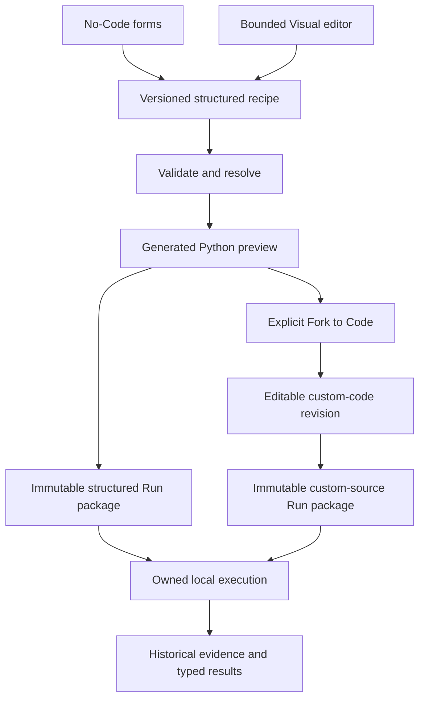

# Three-mode architecture proposal

Date: 2026-10-24. Proposed future architecture; nothing in this document changes
the frozen v0.1 read-only Code contract. Baseline evidence is indexed in
[V0_1_BASELINE_AUDIT.md](V0_1_BASELINE_AUDIT.md); expansion prerequisites are in
[ARCHITECTURE_GAP_ANALYSIS.md](ARCHITECTURE_GAP_ANALYSIS.md).

## Verdict and alternatives

Three experiences are technically viable **if they have two explicit sources of
execution authority**, not three independently mutable pipelines. Forms and a
bounded canvas edit structured intent. Freely edited Python is a separate custom
revision, linked to but not continuously synchronized with its structured parent.

| Approach | Consequence | Recommendation |
| --- | --- | --- |
| Independent form JSON, canvas graph and Python | Multiple truth stores; changes drift; execution may differ from visible state | Reject |
| General executable DAG before new task support | Large compiler/editor migration before evidence of needed graph operations | Defer; unnecessary for current per-feature recipe |
| Shared versioned recipe for forms/canvas; explicit code fork with lineage | Reuses validation/compiler, preserves history, acknowledges Python cannot reliably round-trip | Recommended |

The free-edit requirement rules out a safe general Python-to-node reverse parser.
AST inspection can provide diagnostics later; it must not silently reconstruct a
structured recipe or claim equivalence. The existing template AST parsing in
`codegen/render.py:template_parts` processes bundled helper sources only; it is
not an arbitrary-program compiler or a reverse engineering service.

## Authority and lifecycle

Generated preview is derived, not a mutable source document. Custom source becomes
authoritative only for its custom revision. A user can preserve and reopen either
branch; returning to structured work does not delete or overwrite the custom source.
Existing Runs continue to identify their original source kind/version and bytes.

## No-Code evolution

Keep the existing Data/Explore/Prepare/Train/Evaluate/Runs/Code information
architecture rather than replace it with a mandatory graph. A mode chooses how
the current revision is authored, not whether history can be read.

Reuse `PipelineIR`, contextual issues, Project revisions, reviewed source/plan hashes
and backend validation. Capability descriptors supply model/task forms. Keep
incomplete intent saveable, conflicts explicit and learned transforms train-only.
Guard unsaved Train input before switching mode or revision. Structured changes
must invalidate the reviewed preview using the same backend authority as today.

## Visual Mode: bounded first, general graph later

### First canvas and mapping

The current recipe supports one Dataset, per-feature operation sequences, one
split, one model and one evaluator. Begin with a read-only graph projection, then
allow editing only those semantics:

| Visible node | Mapping / typed ports | Validation and execution meaning |
| --- | --- | --- |
| Dataset | `ir.dataset`; source table/schema outputs | Frozen Dataset identity/fingerprint; preview remains the existing bounded source preview |
| Feature selection | `ir.features[name].included`; column references, not copied values | Target is never included; absent/unsupported columns remain explicit issues |
| Target/eligibility | task-specific `ir.target`; supervised labels/eligible-row policy | Missing-target exclusion is task policy; no target node required for clustering |
| Split | `ir.split`; eligible table -> training/test populations | Learned transforms are not fitted before this boundary |
| Per-feature transform chain | Ordered `features[name].operations`; numeric/categorical/text feature ports | Imputation then allowed scaling/encoding; no invented operation reordering |
| Model | `ir.model`; compatible feature matrix plus training labels where applicable | Catalogue supplies allowed parameters and matrix/task constraints |
| Evaluation | Resolved task evaluation contract; frozen predictions/results context | v0.1 has fixed binary evaluation, not an editable extra-metric node |

Canvas routing should show fit-on-training and transform-on-test as separate
concepts. A visually earlier transform icon must not imply fitting on all source
rows. Do not let users draw a learned preprocessing bypass around the split.
Type checks cover table/column/matrix/labels/predictions/evidence, not only whether
two handles happen to connect.

The first editor must reject cycles, extra Dataset/model branches, unsupported
connection shapes and unsatisfied type/task constraints. Save a canonical recipe
patch through the existing revision guard. Configuration panels edit the same
feature/model/split fields as forms. Use backend issue scope/column/field to map
validation messages to nodes; retain the issue text and accessibility path.

Store canvas layout and selection separately from executable IR. Pan/zoom/position
changes must not alter source/plan hashes. Persisted layout needs its own revision
or write domain so it does not accidentally masquerade as an experiment edit.
No separate graph-as-execution-truth store is needed for the bounded canvas.

### Status, errors and previews

The existing Run response provides lifecycle status and safe failure stages, not
timings/status for every canvas node. First show an overall Run state plus only
supported failure-stage mappings. Never animate an asserted node-by-node execution
progress from a polling timer. Real node events would require new versioned,
bounded immutable evidence and an executor/workload protocol extension.

Source preview can reuse Data. A transformed preview requires an explicit fit
population and ephemeral isolation policy; fitting a transformer on all data to
paint a preview must not become the trained transformer. Defer transformed-node
previews until those semantics are approved.

### Library choice

React Flow is a reasonable candidate for controlled React nodes, handles, selection,
viewport and accessibility affordances; it does not provide ML validation or a
compiler. Its [official guide](https://reactflow.dev/learn) documents those UI
building blocks. A small existing-DOM/SVG read-only projection is cheaper before
editing is needed. Building a full custom editable canvas would require ownership
of keyboard connection creation, zoom/pan, focus and hit-testing; do not choose it
merely to avoid one dependency. General-purpose diagramming editors can add more
semantics than this recipe needs. Confirm package/license/runtime compatibility
when introducing a pinned dependency; nothing is installed during this audit.

### When a true graph becomes justified

Cross-column learned transforms such as PCA, multi-input feature joins or multiple
models cannot always flatten into today's per-column recipe. Introduce a new graph
IR version only then: typed named ports, stable node IDs, explicit dependency/order
rules, topological validation and deterministic resolution. Keep a tested adapter
for old recipe graphs; do not force conversion of old Run snapshots. Forms may
edit only the representable subset of a richer graph and must become read-only
for unsupported structures rather than discard them.

## Code Mode: minimum viable editor and execution

### Revision and storage contract (new, not present today)

`Project.revision` is currently an optimistic current-state counter, not a saved
branch history. Do not treat it as a recoverable historical recipe revision.
At fork, persist a stable revision ID with source kind, parent structured snapshot,
Dataset binding, source SHA-256, plan/provenance at fork, creation timestamp and
user-authored source artifact. Store a current editing draft separately from frozen
Run inputs. A source save creates/updates an explicitly versioned draft; execution
freezes the exact saved bytes into a new immutable package. Never execute an
uncommitted browser buffer while displaying another reviewed source hash.

While a custom revision is selected, No-Code/Visual controls for that revision are
read-only. Selecting the preserved structured parent re-enables those controls;
custom source remains accessible with its lineage. Further structured editing can
create another working revision without rewriting the fork. Switching must resolve
unsaved drafts explicitly. A custom Run records source kind/revision/hash and the
frozen source/contract context; current Project state cannot relabel it later.

### Security and trust boundary

Arbitrary Python has the local user's effective permissions under today's process
model. Environment allowlisting and `-I` do not prevent filesystem/network access,
process creation or malicious outputs. Before exposing a Run button for custom
source, require a clearly stated trusted-local-only policy and explicit execution
consent; remote or mutually untrusted execution is out of scope unless a real
isolation design is introduced separately. Do not advertise a sandbox.

Reuse argument-list launch, workspace leases, timeout/cleanup, journaling and bounded
logs. Add adversarial descendant/pipe/process ownership acceptance cases. Do not
let custom source choose authoritative artifact paths or register arbitrary
external files as managed evidence. Preserve source as untrusted text on read;
never execute it to inspect history. Keep raw custom stdout/stderr local with an
explicit privacy warning; the generated-code sanitizer cannot sanitize arbitrary
prints inside user Python.

Distinguish generated-evaluator results from user-reported custom metrics.
Structural/result validation can reject malformed fields but cannot prove a freely
edited program genuinely trained or measured what it reports. Start custom Runs
with an explicit trust label and no controlled-comparison deltas against generated
Runs. Stronger verified evaluation needs an independently defined trusted evaluator
and prediction-evidence contract. A source hash establishes which program ran,
not that its scientific claims are true.

### Minimum scope and alternatives

- One Python file forked from a generated workload; editor, save, visible lineage,
  explicit execution action, syntax diagnostics and historical exact source.
- Same preinstalled local environment; no arbitrary pip install, shell, terminal,
  language server daemon, debugger, notebooks, extension marketplace or multi-file
  project support. Missing imports become honest execution errors.
- User code may emit a declared custom result protocol or finish without standardized
  evaluation; choose that policy before implementation. Do not silently mark an
  arbitrary script as a normal successful trained-model Run without required evidence.
- Monaco provides a substantial editor surface; its
  [official repository](https://github.com/microsoft/monaco-editor) is the integration
  reference. It is not a full VS Code extension host, debugger or Python runtime.
  CodeMirror is a smaller candidate; a plain textarea is sufficient for a lineage
  prototype but weaker for a released developer editor. Select through a focused
  keyboard/loading/worker compatibility spike after product approval.

Editor loading should be client-only and lazy. Define worker assets/CSP, focus and
bundle-size acceptance. Check exact licenses for the editor, wrappers and language
services. Do not add both editor frameworks, terminals or a new server simply to
display editable text.

## Optional AI boundary

Core editing, validation, execution and evaluation must work with no AI provider,
key or network access. A future optional provider adapter may consume a redacted,
user-approved structured context and propose a patch/source draft. Backend validation,
revision guards and explicit user application remain mandatory. AI cannot silently
change positive classes, task, metric definitions, source authority or historical
evidence. Raw rows and secrets are not default prompt context. No AI dependency,
provider marketplace or agent execution layer is recommended as a prerequisite.

## Acceptance gates and unresolved product decisions

Gates: forms/canvas equivalent semantic intent -> same plan/source; layout-only
edits -> unchanged hashes; unsupported graph -> blocked save; explicit code fork ->
new authority with exact parent preserved; mode switch -> no draft loss; frozen
custom Run -> exact saved source; old v1 Run -> unchanged history; custom outputs
cannot overwrite managed evidence or imply trusted metric equivalence.

Decisions requiring approval: bounded recipe canvas versus a later true DAG; Code
Mode's trusted-local security boundary; mandatory result protocol versus a separate
script-only Run kind; automatic draft save versus explicit save/revision checkpoints;
and whether custom-code execution is a higher near-term priority than new task
families. These proposals are not permission to implement either mode.
